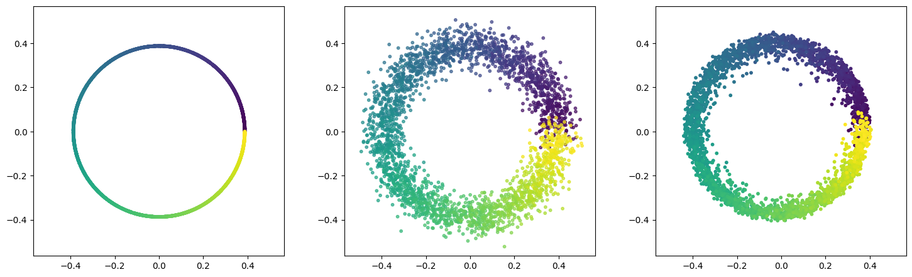
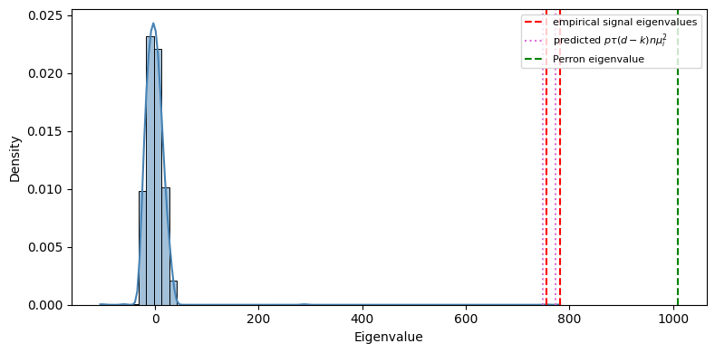
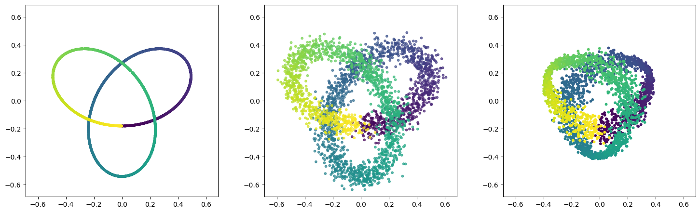

# Spectral recovery of point clouds from noisy geometric graphs

Simulation code for

> T. Brailovskaya, N. Cook, S. Poinelli. *Spectral Recovery of Point Clouds from Noisy Geometric Graphs* (2026).

## The setup

Points `x_1, …, x_n` lie on a low-dimensional curve or surface. Each point is padded into `R^d` and corrupted with isotropic Gaussian noise of variance `1/d` per coordinate. We only observe a **random geometric graph**: an edge `i ~ j` whenever the noisy inner product `⟨s_i, s_j⟩` exceeds a threshold `τ = Ψ⁻¹(p)/√d`, chosen so the edge density is about `p`.

The algorithm recovers the clean point cloud (up to rotation) from the adjacency matrix alone:

1. Take the top `k` non-Perron eigenpairs of the adjacency matrix `A`. If `k` isn't given, it is picked from the spectral gap (`find_spectral_gap`).
2. Rescale the eigenvalues by `1 / (p̂₁ (d − k))`, where `p̂₁` is estimated from the observed edge density (`estimate_p1_hat`).
3. Form the embedding `Ŝ = W · diag(λ)^{1/2}`, so that `Ŝ Ŝᵀ` estimates the clean Gram matrix `X Xᵀ`.

Recovery quality is measured by the relative Frobenius and operator-norm errors of the Gram matrix (`rgg/metrics.py`). `rgg/esd_predicted.py` overlays the theorem's predicted signal eigenvalues, `η_i ≈ p₁ (d − k) n μ_i²`, on the empirical spectrum to check that the outliers sit where the theory says they should.

| Clean · noisy (projected) · recovered | Spectrum: bulk, signal outliers, predicted locations |
|---|---|
|  |  |



## Layout

```
rgg/
  algorithm.py      noise model, RGG construction, spectral algorithm, embedding
  curves.py         test manifolds (circle, trefoil, sinusoid, segments, spiral, Lissajous, …)
  sampling.py       arc-length sampling on curves, swiss roll, sphere
  esd_predicted.py  predicted signal eigenvalues vs empirical spectrum
  metrics.py        relative Gram-matrix errors
  plots.py          pipeline / spectrum / Gram figures, Procrustes alignment
  config.py         default (n, d, p, k, Tr) per curve
scripts/
  run_all_curves.py   pipeline figure for every curve
  sweeps.py           error vs n, d, p, trace (parallel, joblib)
  noise_sequence.py   recovery as noise level varies
  fast_test.py        quick single-run check
  tune_params*.py     parameter searches used for the figures
```

## Running

```bash
pip install -r requirements.txt
python scripts/run_all_curves.py --curves circle trefoil
```

Figures are written to `figures/` (sweeps also write to `new_figures/`). With the default config (`n = 3000`, `d = 500`, `p = 0.1`), the circle run takes a few seconds on a laptop.
